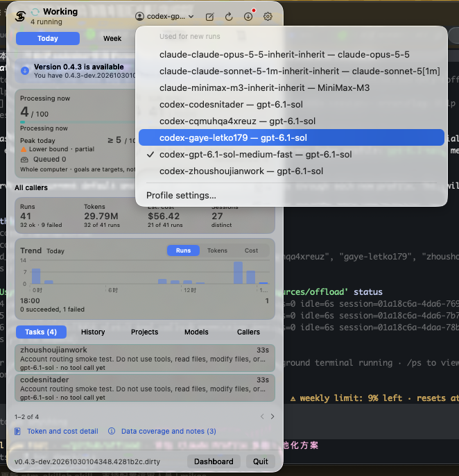

# offload

A subagent for Codex and Claude Code that runs on any model you configure.
For a clearly specified task, the main agent hands offload a self-contained
brief instead of spawning a native subagent. The worker starts with a clean
context, so nothing leaks between it and the main conversation, and only its
final report comes back. The main agent keeps design decisions and final review.

- **Default profile first:** new runs inherit `OFFLOAD_PROFILE` or the configured
  default; explicit per-run overrides remain available when requested or required.
- **Two backends:** Codex CLI and Claude Code with Anthropic-compatible gateways.
- **Named profiles:** a model, provider or managed Codex account, with an optional hint about which tasks it suits.
- **Persistent sessions:** resume related work and inspect previous reports.
- **macOS dashboard:** track tasks, switch profiles and manage accounts.



## Quick start

Requires Go 1.24+ and a signed-in `codex`, or `claude` configured with a supported
gateway. Both backend CLIs run locally.

```sh
go install github.com/zhoushoujianwork/offload@latest
offload config
offload -d /path/to/project "Find the retry logic. Return file:line references. Do not edit files."
```

Use `offload config` to create a profile. For a Codex profile using your existing
sign-in, you can also run:

```sh
offload profile save --json <<'JSON'
{"name":"codex","create":true,"backend":"codex"}
JSON
```

Creating a profile selects it as the default. New features may require building
from the current source with `go install .`.

## Everyday commands

```sh
offload profiles                         # list profiles
offload -p codex -json "Inspect this project without editing files."
offload -w -d /path/to/project "Apply the agreed fix and run the relevant tests."
offload -r <session> "Review the previous change for edge cases."
offload status                           # running and queued tasks
offload show <session>                   # saved reports
offload stats                            # usage and estimated costs
```

`-p` selects a profile for one task; `offload default <name>` changes the saved
default. `OFFLOAD_PROFILE` overrides that default. Resumes retain their recorded
account. Costs are estimates when available, not billing records.

**Execution scope:** default-policy Codex workers bypass approvals and sandboxing.
`-w` communicates write intent; it does not enforce a filesystem boundary. Give
workers a clear task and authorization scope. See [permissions](docs/guide.md#permissions).

## Codex account profiles

Use one profile per account, such as `codex-work` and `codex-personal`.
In the app, open **Settings → Profiles**, choose Codex, then **Sign in…** or
**Import…**. Use **Link…** to share an existing private OAuth `auth.json` instead.
Select the account and save the profile.

```sh
offload accounts add work                # device sign-in
# Or: offload accounts import work < /path/to/auth.json
# Or: offload accounts link work /absolute/path/to/auth.json
offload profile save --json <<'JSON'
{"name":"codex-work","create":true,"backend":"codex","codex_account":"work"}
JSON
offload -p codex-work "Your task"
```

Each managed account keeps private configuration and sessions. Imports copy
credentials; links share only `auth.json`, including external atomic refreshes.
Linking can create an account or convert an existing one with a private recovery
backup. Only Codex's file credential store is supported (verified with Codex CLI
0.167.0). Sharing the file does not serialize concurrent network token refreshes;
avoid refreshing the same account concurrently in multiple clients.

The [agent skill](skills/offload/SKILL.md) tells supervising agents to omit `-p`
and use the active default. Compatible account fallbacks are used only when the
user requests or authorizes them; quota errors never trigger silent rotation.
[Account setup and routing details →](docs/guide.md#managed-codex-accounts)

## Agent integration

Go hosts can import [`pkg/execution`](pkg/execution) to run the same worker in
process, without launching the Offload CLI. See the [package goals and usage
boundary](docs/execution-pkg.md) and [API details](docs/execution-pkg-detail.md).
Host task policy, session serialization, delivery and memory remain with the
calling application.

```sh
offload install-agent
```

Installs the skill and delegation instructions for Codex and Claude Code.
Start a new agent session to load them. Explicit user instructions, including
turning delegation off, take precedence.
[Integration options →](docs/guide.md#set-up-codex-and-claude-code)

## macOS app

Download the Apple silicon or Intel app from [Releases](https://github.com/zhoushoujianwork/offload/releases).
The app includes its own CLI; updating a standalone CLI does not update the app, and updating the app does not change a standalone CLI.
Settings > App lists both, with paths and versions, and can replace a plain standalone copy after you confirm.
Release installation requires confirmation and verifies the downloaded bundle.
The app is ad-hoc signed and not notarized.

For local development:

```sh
make dev          # build, replace the whole App + CLI, and restart
make dev-build    # build only
```

Dev builds display `-dev.<timestamp>.<commit>` and append `.dirty` for uncommitted
changes. `make dev` installs to `~/Applications/Offload Monitor.app`, requests a
normal quit and verifies a new process. Save current work first; it never
force-kills the app. [Development updates →](docs/guide.md#fast-local-development-updates)

## Documentation and development

- [User guide](docs/guide.md): configuration, scheduling, JSON interfaces, limits and troubleshooting.
- [Monitor task controls](docs/monitor-task-controls.md): live output, per-run Stop and explicit Resume.
- [Execution transcript](docs/execution-transcript.md): live and replayable conversation for supervisors.
- [Agent skill](skills/offload/SKILL.md): delegation workflow and account selection.
- [Development and checks](docs/guide.md#development): repository layout and CI commands.
- [Release packaging](docs/guide.md#release-downloads): assets, signatures and updater verification.

[MIT License](LICENSE)

macOS App 运行期间会自动串行复测失效的 profile：启动时先刷新列表，失效至少 30 分钟后才尝试，此后每项至少间隔 30 分钟。关闭设置窗口不影响复测；没有失效项时不会发起模型调用。**Offload 总开关关闭时（设置 > Offload，或 `offload disable`）自动复测和手动 Check profile 都不会启动，也不会产生模型调用；重新开启后恢复。**仅关闭设置窗口、退出界面或停用 Agent 技能都不能代替总开关。设置中的 **Check profile** 可检查任意 profile，**Check all unavailable** 可立即检查所有失效项（会产生最小真实模型调用），并显示进度及取消按钮；取消不会由 App 改写可用状态。
