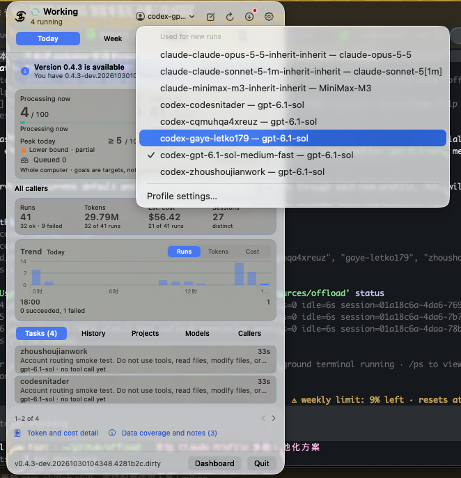

# User guide

[Back to the project overview](../README.md)

Detailed configuration, commands, accounting, permissions and release procedures.
Run shell examples from the repository root.

## Install

Requires Go 1.24+ and the CLI for your selected backend: [Claude Code](https://docs.anthropic.com/en/docs/claude-code) (`claude` on PATH or at `~/.claude/local/claude`) or [Codex](https://developers.openai.com/codex/cli/) (`codex` on PATH, already signed in).

```bash
go install github.com/zhoushoujianwork/offload@latest
```

To install from a source checkout, run `go install .` in that checkout. If an older tagged release does not recognize `install-agent` or `-json`, use a checkout containing these features.

## Configuration

Run `offload config`, select **Profile**, then **Add profile** to save a bundle and use it immediately. This also works before a configuration file exists. Or create `~/.config/offload/config.json` (chmod 600):

```json
{
  "default": "minimax",
  "profiles": {
    "minimax": {
      "base_url": "https://api.minimaxi.com/anthropic",
      "model": "MiniMax-M3",
      "endpoint": "cc",
      "token_cmd": "security find-generic-password -s offload-minimax -w"
    },
    "codex": {
      "backend": "codex",
      "model": "gpt-6.1-sol",
      "reasoning_effort": "low",
      "service_tier": "default"
    },
    "codex-deep": {
      "backend": "codex",
      "model": "gpt-6.1-sol",
      "reasoning_effort": "xhigh",
      "service_tier": "priority"
    },
    "deepseek": {
      "base_url": "https://api.deepseek.com/anthropic",
      "model": "deepseek-chat",
      "endpoint": "llm",
      "token_cmd": "printenv DEEPSEEK_API_KEY"
    }
  }
}
```

`token_cmd` (preferred) prints the token on stdout, so secrets can live in the macOS Keychain, `pass`, 1Password CLI, etc. A literal `token` field also works.

Optional `endpoint` (`cc` for a Claude Code proxy, `llm` for a generic LLM gateway) applies to Claude profiles only. It is an informational label shown by `offload profiles` and in the settings wizard; it does not change requests. Unknown values and Codex profiles with an endpoint are rejected.

### How switching works

Profiles select a `backend`: `claude` (the default for existing profiles) or `codex`. Claude profiles provide the three variables Claude Code reads. For each Claude run, offload drops every `ANTHROPIC_*` variable from the caller's environment and sets exactly:

| profile field | worker env |
|---|---|
| `base_url` | `ANTHROPIC_BASE_URL` |
| `token` / `token_cmd` | `ANTHROPIC_AUTH_TOKEN` (sent as `Authorization: Bearer`) |
| `model` (or `-m` override) | `ANTHROPIC_MODEL` |

`--setting-sources ""` disables user, project, and local settings so their environment overrides cannot replace the profile's gateway, token, or model. `--bare` alone does not isolate settings. Authentication is environment-only; no `apiKeyHelper` or `--settings` argument is used. Tokens never appear in argv.

### Codex workers

A profile with `"backend": "codex"` runs `codex exec --json`. It uses your existing Codex authentication, provider, and configuration, including `CODEX_HOME`. The optional `model` field or `-m` selects a model; omit both to use the Codex default. Log in with the native Codex CLI before running a Codex profile. Optional `reasoning_effort` and `service_tier` override native settings for that worker only; omitted or empty values inherit them. The wizard offers Inherit/Low/Medium/High/Extra high reasoning and a **Fast** switch: Off saves `service_tier` `default` (standard service) and On saves `priority`. A new profile starts Off. A saved profile with no tier shows an extra "Not set" choice, preselected, that keeps it inheriting the native Codex setting; opening settings and cancelling never rewrites a profile, and choosing Off or On saves that explicit value for later runs. The macOS Settings Profiles form has the same Off/On control for Codex profiles. Claude profiles have no Fast control. Fast changes the execution service tier only; it is not a token, cost or end-to-end duration guarantee. Gateway fields (`base_url`, `token`, `token_cmd`) apply only to Claude profiles. `OFFLOAD_CODEX` can override the Codex executable.

By default, Codex runs with `--dangerously-bypass-approvals-and-sandbox` for both read-only and `-w` tasks; offload adds no sandbox (see Permissions below). Instructions and the task are sent over stdin. Codex also discovers its own agent instructions. JSONL events supply the report, session ID, and live tool progress; `turns` counts tool calls. Codex reports cumulative token usage. offload preserves run-scoped tokens and can calculate the limited API baseline estimate described below; this is separate from native billing.

Interrupted Codex runs retain progress and a resume command. Automatic tool-less salvage is supported only for Claude.

### Choosing a profile

Choose per run with `-p name`, per shell with `OFFLOAD_PROFILE=name`, otherwise through `default` in the config. `offload profiles` lists profiles (name, backend, endpoint or `-`, model, base URL), with `*` marking the selected default; it never prints tokens.

Profiles may declare `"aliases": ["cc", "fast"]`. Each alias must match `[a-z0-9-]{1,32}`, be unique across all profiles, and differ from every profile name. Use aliases with `-p cc`, `OFFLOAD_PROFILE=cc`, or `offload default cc`; the saved default and run records use the resolved full name. JSON results and history also include `profile_alias` when an alias selected the run. Resuming a session keeps its stored profile name. `offload profiles` displays aliases, and `offload config` lets you edit a comma-separated alias list (clear it to remove all aliases).

```bash
offload profiles
offload default codex     # save Codex as the default
offload default minimax   # switch back to Claude through this profile
offload default           # show the saved default
offload -p codex -d /absolute/path/app "Summarize README.md, max 5 bullets."
offload -p minimax -d /absolute/path/app "Summarize README.md, max 5 bullets."
OFFLOAD_PROFILE=deepseek offload -d /absolute/path/app "Find retry entry points, max 10 file:line rows."
```

`offload default <profile>` validates the profile and saves it without changing other configuration fields. `OFFLOAD_PROFILE` still overrides the saved default for new runs. Resuming a known session reuses its original profile and directory; `-p` and `-d` explicitly override them. Additional `--add-dir` directories are inherited from the latest run unless replaced or cleared.

`-m` overrides the selected profile's model for that run.

## Worker limits

Independent `offload` invocations share a per-user, machine-wide worker limit. Runs over the limit wait in a queue before any backend starts; `offload status` and `watch` show them as `queued` with the reason. Interrupting or sending SIGTERM to a queued run cancels it without launching a backend.

```json
{
  "limits": {
    "max_workers": 2,
    "go_max_procs": 2,
    "go_parallelism": 1
  }
}
```

- `max_workers`: workers allowed at once across all terminals and projects. Unset, it defaults to a quarter of the logical CPUs (at least 1), so an 8-CPU machine gets 2. `-1` turns the limit off. `OFFLOAD_MAX_WORKERS` overrides it for one invocation. Tune it for your machine; the default is a starting point, not a measured optimum.
- `go_max_procs` and `go_parallelism`: defaults added to the worker's environment as `GOMAXPROCS` and `-p=N` in `GOFLAGS` (defaults 2 and 1; `-1` disables). A `GOMAXPROCS` or `-p` you already set is kept, and other `GOFLAGS` are preserved. These are Go build settings, **not** CPU or memory limits: they do not constrain `xcodebuild`, other build tools, or a worker that overrides its environment.
- A worker holds its slot through the run, any salvage step, and cleanup. It leads its own process group; on completion, `-t` timeout, the configured idle limit, Ctrl-C or SIGTERM, offload sends SIGTERM to the group, then SIGKILL after 5 seconds, and releases the slot only once the group is empty. It never signals processes outside that group and never kills by executable name.
- Wait and execution time are reported separately (`wait=` and `exec=` in the summary line, `wait_ms` and `exec_ms` in `-json`). `-t` applies to execution only; time spent queued does not count against it. `elapsed` is the total.
- Only one process can drive a resumed session: of two simultaneous `-r` runs, the second is refused.
- If worker processes cannot be stopped, the run is reported with `cleanup=unresolved` and its slot stays unavailable until they exit. If offload itself is killed (SIGKILL, crash), the slot is not reused while the recorded process group is alive, and `status` shows the worker as `lost` with `(worker processes alive)` rather than finished. A recycled PID is told apart by process start time.

These limits cover offload workers only. Builds and tests that a supervising agent starts itself bypass the queue, so one heavy build at a time across a whole workflow still needs a serial validation policy in the supervisor.

## Delegation mode

Delegation mode controls how proactively the installed policy tells a supervising agent to hand work to offload. It is independent of the provider `profile`/model selection above and does not change worker permissions, which offload never restricts (`-w` still states that the task may edit).

| Mode | Behavior |
|---|---|
| `basic` | Mainly delegates research, code localization, summaries, and bounded mechanical edits. Whole-feature implementation stays with the main agent unless the user explicitly requests delegation. |
| `proactive` (default) | Also delegates bounded feature/bugfix implementation, its tests, and docs: the main agent decides requirements, interfaces, behavior, allowed files, and acceptance checks, then actually invokes `offload -w`. |

In both modes, actually invoking offload is the default before substantial bounded supporting work, to reduce the supervising model's token use: cross-file localization, bounded evidence gathering, comparisons, and bulk summaries go to a worker before the same material is read locally. One quick orientation lookup is fine; when it expands, delegate. Scope may be narrowed after that orientation, and an open-ended overall objective is not a reason to keep all bounded research local. Otherwise eligible execution work stays local only for a concrete tiny known-file check, a user restriction, a security boundary, or an unavailable worker, with a brief stated reason. Trivial tasks need no call, and savings are not claimed without measurement.

Both modes keep architecture/design decisions, important tradeoffs, and final independent review with the supervising agent, and keep the existing scope, monitoring, resume, and no-recursive-worker rules.

```bash
offload mode              # print the saved mode (unset config defaults to proactive)
offload mode basic        # switch both installed agents (user scope) to basic
offload mode proactive    # switch back to proactive
```

`offload mode` with no argument only reads the saved mode and does not create a config file or touch installed instructions. Setting it validates the mode first, then updates the installed policy/skill for both Codex and Claude Code (user scope) using the same install logic as `install-agent`, and finally saves `delegation_mode` in the config, preserving every other field (profiles, default, credentials). If persisting the choice fails after the instructions were already updated, the command reports that explicitly so you know the files and the saved mode are out of sync. Repeating the same mode leaves already matching files unchanged. **Start a new agent session after changing the mode** so it picks up the updated instructions; a session already running keeps its previously loaded copy.

## Interactive settings

```bash
offload config   # open settings in an interactive terminal
offload          # also opens settings when stdin and stdout are terminals
```

Use the up/down arrow keys to choose an item and Enter to confirm. Each change is automatically saved and applied when confirmed, with no separate Save or Apply step. Ctrl-C cancels a submenu or exits the main menu; cancelling does not save a change.

The **Offload level** setting uses a horizontal slider. Press Left/Right to choose **Less offload** (`basic`) or **More offload** (`proactive`), then Enter to apply. More offload shifts more work away from the caller model: it also delegates implementation, tests, and documentation after the main agent designs the change. Less offload covers research, code lookup, and mechanical changes. The main agent always owns design and final review. Actual caller token savings depend on the task and coordination overhead; this is a work-sharing setting, not a measured savings percentage. Existing mode values and CLI commands remain compatible.

The main menu contains **Profile**, **Offload level**, and **Exit**. Profile lists saved bundles with their backend, model, and explicit reasoning and Fast settings. Enter on a saved bundle immediately selects it for the next task. **Add profile** collects a new bundle; **Edit current profile** updates the saved default's backend-specific fields while keeping its name and backend. There is no separate model setting. Long menu items shorten to fit the terminal width. An `OFFLOAD_PROFILE` shell override is shown separately and still takes precedence.

Codex models may be empty to inherit the native default. Claude gateway profiles require an HTTP(S) base URL, model, and token command or masked API token. Configuration never executes the token command. Editing can keep current authentication without displaying it, or replace it. A completed wizard saves the entire bundle atomically; Ctrl-C at any step leaves configuration unchanged.

Mode changes also update the installed Codex and Claude instructions. Start a new agent session to load them. The interactive menu hides successful installation/save logs and returns to the current settings; errors remain visible. Piped task input and existing non-interactive commands continue to work as before.

## Set up Codex and Claude Code

Install the bundled skill and delegation policy into each supervising agent's main instruction file:

```bash
offload install-agent                         # both agents, user scope, saved mode (default proactive)
offload install-agent -agent codex            # Codex only
offload install-agent -agent claude           # Claude Code only
offload install-agent -scope project -d /absolute/path/app
offload install-agent -mode basic             # install basic mode for this run only; does not change the saved mode
```

`-agent` accepts `codex`, `claude`, or `all` (default). `-scope` accepts `user` (default) or `project`. Project scope defaults to the current directory; `-d` is only valid with project scope. `-mode` accepts `basic` or `proactive` and overrides the mode for that install only; without it, `install-agent` uses the saved mode from `offload mode` (absent config defaults to `proactive`). This installs instructions and skills; configure gateway credentials separately above.

| Agent / scope | Skill directory | Main instruction file |
|---|---|---|
| Codex / user | `~/.agents/skills/offload` | `$CODEX_HOME/AGENTS.md` (default `~/.codex/AGENTS.md`) |
| Claude Code / user | `$CLAUDE_CONFIG_DIR/skills/offload` (default `~/.claude/skills/offload`) | `$CLAUDE_CONFIG_DIR/CLAUDE.md` (default `~/.claude/CLAUDE.md`) |
| Codex / project | `<dir>/.agents/skills/offload` | `<dir>/AGENTS.md` |
| Claude Code / project | `<dir>/.claude/skills/offload` | `<dir>/CLAUDE.md` |

The installer preserves unrelated instructions and maintains one `<!-- offload:begin -->` … `<!-- offload:end -->` block. Repeating the command updates that block and an unchanged installer-owned skill; it does not duplicate them. It prints `installed`, `updated`, or `unchanged` for each file.

Existing unmanaged, edited, or symlinked skill targets are preserved and installation fails before writing. Inspect and back up the existing skill directory or link before moving it aside and rerunning. Also migrate older `~/.codex/skills/offload` links to avoid duplicate skill names. There is no force-overwrite mode.

Codex's current skill locations are documented in [Build skills](https://learn.chatgpt.com/docs/build-skills#where-codex-loads-local-skills); `CODEX_HOME` controls its instruction/state directory, not this installer's user skill directory. The installer warns if `AGENTS.override.md` replaces `AGENTS.md`; include the policy in your active instructions. Start a new agent session to load changed instructions; verify that the `offload` skill is available.

### Main agent and subagent workflow

The installed policy asks main agents and native subagents to actually invoke offload before doing substantial bounded supporting work themselves, according to the active delegation mode. In **proactive** mode this includes bounded implementation once the design is decided; in **basic** mode it mainly covers research, localization, summaries, and bounded mechanical edits, without proactively handing off a whole feature's implementation. In both modes, the main agent owns requirements, architecture/design, tradeoffs, task decomposition, and final review/acceptance. If a worker finds the design, scope, or architecture needs to change, it reports findings/options back instead of redesigning on its own. Prefer calling the CLI directly, without native subagent overhead, and avoid duplicating work an active worker is already doing. For parallel work or independent review, a native Codex subagent can launch the external worker:

```text
Main agent → optional native subagent → offload → selected Claude/Codex profile
                 ← verified conclusion + worker metrics ← final report
```

This uses an external worker process; it does not change Codex's native subagent model provider. Give a suitable subagent this instruction for bulk reading:

> Use offload for the bulk reading in /absolute/path/app, read-only. Find retry entry points and tests; return at most 10 file:line rows. Verify two key references and report the model, session, estimated worker cost, and elapsed time.

In **proactive** mode, once the design is decided, hand off bounded implementation the same way, explicitly with `-w`:

```bash
offload -w -json -d /absolute/path/app "Design decided: expose the existing 3-attempt retry limit as maxAttempts (default 3); preserve backoff and error behavior. Only edit internal/http/client.go and internal/http/client_test.go. Update the API comment, test default and explicit limits, and run go test ./internal/http. No commit, push, or unrelated changes. Report changes, check results, and any design questions."
```

In **basic** mode, keep whole-feature implementation in the main agent; `-w` is still available for mechanical edits or work the user's task explicitly authorizes, such as a scoped rename across a package.

Check uncertain API assumptions before handing off a large implementation: use a scoped read-only probe of the installed API or a minimal reproduction, then delegate one coherent slice with known entry points and acceptance checks. Both worker backends are instructed to return a **BLOCKED** report after an inconclusive focused feasibility check, including evidence, edits made, checks run, and the decision needed from the supervisor. This is a model instruction, not a hard tool-call limit; timeout and cancellation behavior are unchanged. Avoid killing a still-active worker solely because it has not edited yet and then duplicating its investigation locally. Refine the task using its findings and resume the existing session; deliberate cancellation skips automatic salvage, so recover a report with a report-only resume if needed.

Keep short conversations, trivial lookups, architecture choices, sensitive changes, and final review with the supervisor. Workers already launched by offload should finish their assigned task directly instead of delegating again. Default to read-only for inspection; use `-w` explicitly for authorized implementation rather than silently falling back to read-only. Spot-check reports; after authorized `-w` work, inspect the actual diff and independently run relevant checks yourself.

## Lowering parent overhead

Calling offload does not by itself keep the supervising model's usage low. Repeated launches, short status polls, and re-doing the worker's investigation all cost parent turns. The installed policies, the bundled skill, and this section describe the same workflow.

**Reuse a session for related work.** Investigation, implementation, and review corrections for the same task or slice go through `offload -r <session>`. A resume keeps the session's profile and directory. Start a new session for an unrelated task, a different directory or profile, or stale context; do not put every task in one session. Backend compaction means history is neither unlimited nor verbatim, so each follow-up restates the current corrections and acceptance criteria.

```bash
# 1. investigate (read-only); the session id is in the summary line
offload -json -d /abs/app "Find where retry limits are applied; file:line | purpose, max 10 rows."
# 2. implement in the same session once the design is decided
offload -r <session> -w -json "Design decided: expose maxAttempts (default 3). Only edit internal/http/client.go and client_test.go; run go test ./internal/http."
# 3. inspect the diff, run scoped checks, send review fixes to the same session
offload -r <session> -w -json "Review fix: keep backoff unchanged when maxAttempts is 1; add a test. Acceptance: go test ./internal/http passes."
# 4. unrelated work starts a new session
offload -w -json -d /abs/docs "..."
```

- **Name the conversation instead of storing its id.** `offload -thread <key> "task"` starts a session the first time and resumes it every time after. The key is 1-128 characters from `A-Z a-z 0-9 . _ -`, and the saved session is scoped to the key, the backend, the profile and the directory (`-d`, or the current directory), so another worktree gets its own session. Use a stable name such as `issue-39`. `-thread` cannot be combined with `-r`.

  ```bash
  offload -thread issue-39 -json -d /abs/app "Find where retry limits are applied."
  offload -thread issue-39 -w -json -d /abs/app "Design decided: expose maxAttempts (default 3). Only edit internal/http/client.go."
  ```

  - **The task is sent unchanged.** A resumed session already holds its earlier turns, so a follow-up carries only the new instruction, corrections and acceptance criteria. Do not paste the original task or earlier conclusions again; that is billed as new input on every turn. Compaction still means history is not verbatim, so name anything the worker must not assume.
  - **A missing session falls back to a new one.** If the backend reports that the saved session no longer exists, offload says so on stderr, starts a new session without the earlier conversation, and rebinds the key. Any other failure keeps the binding, so the next call resumes the same session.
  - **A different backend or profile is refused** (exit 2) instead of silently switching provider. `-thread-reset` starts a new session for the key and replaces the binding.
  - **One run per key.** A second call on a key that has an active run exits 2 with `already has an active run`.
  - **Where it shows.** `offload ls` and `offload show` print the key and whether the run was `fresh`, `resumed`, `reset` or `fallback`. `offload history show --json` carries `thread` and `thread_start`. `offload stats` adds `thread runs: N (resumed, fresh, fell back to fresh)` once any run has used `-thread`.
  - **Cache.** Resuming reuses the conversation, not the provider's prompt cache. Cache hits depend on the backend and gateway: resumed Codex runs have shown high cached input, while a Claude gateway that does not report cache usage shows none, so a long resumed Claude session still pays for its whole history on every turn.
- **One run per session; no overlapping follow-ups.** `offload -r` refuses a session that still has an active run (exit 2). Wait with `offload watch -t`, then resume.
- **Profile safety.** A resume uses the session's recorded profile. If it was renamed or deleted, offload stops with recovery steps instead of falling back to the default provider. Restore the profile, or start a new session with `-p` and restate the context.
- **Interrupted runs.** Inspect with `offload show <session>` and `git diff` first. Partial edits stay in the tree; the follow-up says what to keep or finish.

**Continue a failed task without rebuilding its invocation.** For runs recorded by this version,
call `offload resume --id <run_id-or-session_id> --json`. This starts one new invocation in the
same provider session; there is no background recovery loop or in-process retry. With a session
ID, the latest recorded run supplies the settings. A run ID selects that exact run's settings.
The continuation asks the worker to verify existing edits, commits, checks and external effects
before completing the remaining original task.

The saved settings retain write intent, model, profile, working/additional directories, tool
restrictions, execution policy, sandbox choice, instructions-file path, timeout, idle limit and
salvage choice. Credentials are resolved from the current profile, never copied to the saved
settings. An instructions file must still exist and pass the normal checks. Missing profiles,
changed backends and busy sessions are rejected; directory and account checks remain in force.
Profile credentials and instruction-file contents are not frozen snapshots.

```bash
offload resume --id <failed-run-id> --json --caller clawflow \
  --caller-run-id <new-attempt-id> --events-file /absolute/private/new-attempt.ndjson
```

Each invocation gets a new `run_id`; `resumed_from` identifies its source run. Supply a new
caller/correlation and event destination as needed: they are never inherited. Final JSON and
metadata events use the existing run contract. `history list/show --json` adds
`resume_available` (supported saved settings and no known active session), and history runs
include the native `run_id` and `resumed_from`. This indicator does not guarantee provider,
profile or filesystem availability; admission checks run when resume is requested. Old records
without saved settings and runs without a provider session cannot use this command; inspect
them and use `offload -r <session> <explicit flags> "follow-up"` where appropriate. A deliberate
resume of a completed session is allowed, so supervisors must select failures by their own policy.

**Wait less often.** `offload watch -t 10m` prints events (started, progress, `STALLED`, `LOST`, finished) and returns when all workers end (exit 0) or when the bound passes with workers still active (exit 124, which is not a worker failure). Prefer the host's completion notification for background commands; otherwise use a few long bounded waits within the host's responsiveness limit instead of a status check every few seconds. Waiting is headless and never touches the desktop.

**Don't repeat the worker's work.** The parent keeps requirements, design, tradeoffs, and acceptance; it delegates a coherent slice, inspects targeted evidence or the diff, and runs scoped checks. Workers return a compact report (outcome, changed files or key references, checks, unresolved issues); `offload show` has the full history.

**Reproducible comparison.** `go test ./internal/cli -run TestPollingCoordinationComparison -v` runs a fake long-running worker headlessly and logs, per waiting strategy, the parent turns (one offload CLI call each), elapsed time, exit codes, and whether the outcome was seen. Example output from one run on a 3s worker (timings are scaled down, so only the turn counts and visibility are meaningful):

```text
short poll (status/400ms)    turns=10 elapsed=3.6s exit_codes=[0 0 0 0 0 0 0 0 0 0] outcome_seen="status=ok exit_code=0"
one long watch (-t 30s)      turns=1  elapsed=3.1s exit_codes=[0]                    outcome_seen="status=ok exit_code=0"
bounded watches (-t 1s)      turns=4  elapsed=3.1s exit_codes=[124 124 124 0]        outcome_seen="status=ok exit_code=0"
```

The same test checks that a failed worker, a timeout, and a stall stay visible under a long watch. It counts parent turns only. Parent and worker tokens (cached or noncached) and cost are not measured there and stay unavailable, so these counts are not a token or cost saving. A worker that ends between two bounded watches is reported by the next one as `recently finished`.

When measuring this, report parent polling/tool turns, parent and worker token usage where available (cached input separately from noncached), elapsed time, and failures. Cost stays unknown when unavailable, and savings are not claimed without a comparable baseline.

## Usage

```text
offload [flags] "task"        run a task (task may also come on stdin)
offload config               open interactive settings (terminal only)
offload ls [n]                list the last n runs (default 10)
offload show <session>        print every report of a session
offload status                what each worker is doing right now
offload stats [--json] [--period today|week|month|all]
                              run, token and cost totals for a period (default today)
offload watch [-t dur]        one line per event (started, progress, STALLED, finished) until all workers end;
                              with -t, stop after dur and exit 124 if workers are still active
offload schedule add|list|show|update|pause|resume|delete|results|start|status
                              scheduled tasks (see "Scheduled tasks")
offload profiles [--json]     list profiles (* = the one a run would use); --json is a redacted machine-readable list
offload profile save --json   create or edit one profile from a JSON request on stdin
offload default [profile]     show or set the saved default profile
offload mode [basic|proactive] show or set the saved delegation mode
offload install-agent [flags] install skills and delegation agent instructions
offload agent status [--json] user-scope skill/instruction state for Codex and Claude Code
offload agent enable|disable --agent codex|claude|all [--json]
offload feedback              print the project homepage URL and open it in the default browser
offload version

  -p profile   profile name (default: $OFFLOAD_PROFILE, then config default)
  -m model     override the profile's model
  -w           task intent: the task may modify files (default: told to stay read-only); instruction only, no tool or sandbox limit either way
  -r session   resume a session; reuses its original dir unless -d is given
  -thread key  continue a named conversation: first run starts a session, later runs with the key (and dir) resume it; not combinable with -r
  -thread-reset  with -thread: start a new session for the key instead of resuming
  -d dir       working directory (default: cwd)
  --add-dir d  additional directory for the worker; repeatable; a resume inherits the saved set unless this replaces it
  --clear-add-dirs  resume without the saved additional directories (not combinable with --add-dir)
  -t 30m       worker timeout
  -idle 10m    空闲时限；0 禁用；managed-development 默认 30m
  -no-salvage  do not ask a stopped worker for a report from what it already read
  -json        emit one JSON run record instead of report-only stdout
```

- **Additional directories**: `--add-dir DIR` (repeatable) is forwarded to the backend's native `--add-dir` (Claude Code and Codex) so one worker can span repositories. `-d` still sets the working directory. Relative paths resolve against the directory you run `offload` from, as `-d` does, so absolute paths are recommended in handoffs. Each must be an existing directory, or offload exits 2 before starting a worker. Duplicates and the working directory itself are dropped, and symlinks are not resolved. The effective set is recorded per run as `add_dirs` (shown by `offload show`, `-json` and `history`). A resume inherits the set saved by the session's latest run; any `--add-dir` replaces it entirely and `--clear-add-dirs` empties it. A saved directory that no longer exists stops the resume with both recovery options. Older history without the field means no extra directories. The worker does not read added code automatically, and this is not an access allowlist: workers still run with permission checks bypassed, so name the allowed read and write scope in the task.

```bash
offload -json -d /abs/app --add-dir /abs/lib "Compare retry config parsing in app and lib. Read-only."
offload -r <session> -json "Follow-up"                      # inherits /abs/lib
offload -r <session> -json --add-dir /abs/shared "Follow-up" # replaces the saved set
offload -r <session> -json --clear-add-dirs "Follow-up"      # clears it
```

- **stdout**: the final report by default, or one record with `-json`. **stderr**: one summary line with status, exit code, profile/model, turns, estimated cost, elapsed time (plus `wait=` and `exec=` for a run that was admitted through the worker queue), and session.
- **Exit codes**: 0 ok, 1 worker error, 2 usage/config error or unreachable gateway, 124 timeout.
- **History**: runs, including failures, are appended to `$XDG_STATE_HOME/offload/runs.jsonl` (default `~/.local/state/offload/runs.jsonl`). Use `ls` for per-run metrics, `show` for reports and metrics, or `-r` to resume a session.

`offload ls 3` shows the last three runs in append order. Each compact four-line summary includes status, elapsed time, backend-dependent turns, estimated cost, project basename, profile, a task excerpt, and the full session ID. Unknown metrics remain explicit. Use `offload show <session>` for the full project path and report.

```text
2026-10-26T10:00:00Z | OK | 1m47s | 4 turns | est. $0.0123
  app | cheap / m-1
  Review the retry logic
  Session: 12345678-1234-1234-1234-123456789abc
```

### Scheduled tasks

`offload schedule` runs a task later or repeatedly. You choose the task and the schedule; nothing is scheduled by default.

```sh
offload schedule add --name nightly --cron "30 2 * * *" --tz Asia/Shanghai -d /abs/app -p cheap "Summarize yesterday's failing tests. Read-only."
offload schedule add --every 6h -d /abs/app "Check dependency advisories"
offload schedule add --at 2026-11-01T09:00 --tz America/New_York -w -d /abs/app "Apply the migration plan"
offload schedule start                     # keep this running; due tasks start from here
offload schedule list [--json]             # state, schedule, next run, last result
offload schedule show nightly [--json]     # full definition, including the prompt
offload schedule results nightly --latest  # report of the newest run (also: --run ID, --limit N, --json)
offload schedule update nightly --cron "0 3 * * *" -m other-model ["new prompt"]
offload schedule pause nightly | resume nightly | delete nightly
offload schedule status [--json]           # is a scheduler running?
```

A task is addressed by its id (`t-xxxxxxxx`), its `--name`, or an unambiguous id prefix.

**Schedule syntax.** Give exactly one of:

- `--cron "M H DOM MON DOW"`: five fields, evaluated in `--tz`. Each field takes `*`, `N`, `A-B`, comma lists, and `*/N` or `A-B/N` steps. Months and weekdays accept names (`jan`, `mon`); `0` and `7` are Sunday. When both day-of-month and day-of-week are restricted, either may match (classic cron). Seconds, `@daily` and `L`/`W`/`#` are not supported.
- `--every DUR`: a fixed interval of at least 1 minute (`90m`, `6h`), counted from the moment the schedule is saved or updated.
- `--at TIME`: one occurrence. RFC3339 with an offset (`2026-11-01T09:00:00+08:00`, the offset wins) or `YYYY-MM-DDTHH:MM[:SS]` read in `--tz`. It must be in the future.

**Timezones.** `--tz` takes an IANA name and is stored with the task, so the schedule means the same thing on any machine. It defaults to the machine's zone, detected from `$TZ` or `/etc/localtime`; if that fails, `add` asks for `--tz`. `Local` is refused. Cron times follow the zone's daylight-saving rules: a wall-clock time that does not exist (spring forward) is skipped that day, and one that occurs twice (fall back) runs once, at its first occurrence. `show`, `list` and `--json` print the next run in the task's zone (`next_run_local`) and in UTC (`next_run`).

**What a run is.** Each occurrence starts an ordinary `offload -json` process with the saved prompt (sent on stdin), working directory, `--add-dir`, profile, model, `-w`, execution policy, timeouts and tool options. It therefore uses the normal worker lifecycle: the machine-wide worker limit (`limits.max_workers`) queues scheduled runs with everything else, and `offload status`, `watch`, `ls` and `stats` see them. Each run's `caller_run_id` is `sched:<task id>:<run id>`. A task stores only the profile **name**. The token is read through `token_cmd` or `token` in the profile when the run starts, and is never copied into the schedule files. If the profile is later renamed or deleted, the run fails with a normal "unknown profile" result. Without `-p`, the default profile at run time applies.

**Starting the scheduler.** Schedules are stored on disk, but only a running scheduler starts them. `offload schedule start` is a foreground process that checks every 15 seconds (`--interval`). Only one runs per user state directory; a second one exits with an error. Keep it alive with whatever you already use: a terminal multiplexer, `launchd`, `systemd --user`, or `nohup offload schedule start &`. Alternatively run `offload schedule start --once` from cron or a timer: it starts everything due, waits for those runs to finish, and exits. Stopping the scheduler (Ctrl-C or SIGTERM) does not stop runs it already started; the next scheduler records their results when it sees them finished. offload installs no background service and no login item.

**Sleep, downtime and missed runs.** The scheduler compares the wall clock at each check, so a machine that slept or a scheduler that was down resumes on wake or start. For an occurrence more than 2 minutes overdue (`--misfire-grace` on `start`), the task's `--misfire` policy applies:

- `skip` (default): nothing runs. A `missed` result records how many occurrences were overdue, and the next run is the next future occurrence.
- `run-once`: one catch-up run starts at once, however many occurrences were missed. It is never one run per missed occurrence.

Time a task spends paused is never caught up; `resume` computes the next occurrence from that moment.

**No overlap, no duplicates.** An occurrence is claimed in the task file before its process starts, so two schedulers or a restart cannot start it twice. If the previous run of a task is still going when the next occurrence is due, that occurrence is recorded as `skipped` and not started. If the global switch is off (`offload disable`), due occurrences are recorded as `skipped` and not started; `offload enable` takes effect from the next occurrence, and skipped ones are not replayed. If a run's process disappeared without a result (reboot, `kill -9`), the next scheduler records it as `lost` and does not run it again.

**Failures.** A failed or timed-out run is recorded and counted in `consecutive_failures` (reset by the next success). It is not retried; the schedule continues with its next occurrence. The execution policy, `-t` timeout and idle limit saved with the task apply to every run.

**Results.** Per task, the newest 50 runs are kept (`--keep N`), plus separately the newest 50 `missed`/`skipped` records, in `$XDG_STATE_HOME/offload/schedules/` (default `~/.local/state/offload/schedules/`). A result has `status` (`ok`, `failed`, `timeout`, `missed`, `skipped`, `lost`), `scheduled_for`, start and finish times, `exit_code`, `session`, the worker's `report`, the tail of offload's stderr, and the full run `record`. Every scheduled run is also appended to the normal run log, so `offload show <session>` and `offload -r <session>` work on it. `list --json`, `show --json` and `results --json` print documents with `schema_version: 1` for automation. `update` changes only the flags you pass; changing the schedule recomputes the next run, and `delete` removes the definition and its retained results.

### Settings JSON commands

These commands back the native app and are usable from scripts. The JSON is additive: the plain-text `offload profiles` and `offload default` output is unchanged.

```sh
offload profiles --json
echo '{"name":"work","model":"m-2"}' | offload profile save --json  # edit an existing profile
offload agent status --json
offload agent enable --agent codex --json     # also: disable, --agent claude|all
```

- `profiles --json` prints `schema_version` (1), `config_exists`, `configured_default`, `active`, `active_source` (`environment`, `config` or `none`), `delegation_mode`, `profiles` (sorted by name) and `warnings`. Each profile has `name`, `backend`, `base_url`, `base_url_redacted`, `model`, `endpoint`, `reasoning_effort`, `service_tier` and `auth_mode` (`token_cmd`, `token` or `none`). It never prints a token or token command, and never runs the token command. A `base_url` containing credentials, a query or a fragment is withheld (empty, `base_url_redacted: true`). A missing config is not an error (`config_exists: false`, empty list). `active` follows the run rules, so `OFFLOAD_PROFILE` wins over the saved default.
- `profile save --json` reads one JSON object from stdin (at most 64 KiB, unknown fields rejected) and prints the updated, redacted list. Fields: `name` (exact, required, cannot be renamed), `create` (bool), and optional patches `backend`, `base_url`, `model`, `endpoint`, `reasoning_effort`, `service_tier`, `auth_mode` (`preserve` default, `token`, `token_cmd`, `none`) and `secret`. Omitted fields keep their stored value, including current credentials and a private base URL. `secret` is required for `token` and `token_cmd` and refused with `preserve` or `none`; it is only accepted on stdin, never as an argument. A new profile defaults to the Claude backend and becomes the saved default, as in `offload config`. Claude profiles need authentication; Codex profiles do not. Errors are fixed messages that never echo request values. There is no rename or delete.
- `agent status|enable|disable` act on user scope only (Codex policy under `$CODEX_HOME` or `~/.codex`, skill under `~/.agents/skills`; Claude under `$CLAUDE_CONFIG_DIR` or `~/.claude`), using the install planning shared with `install-agent`. Status reports each agent as `enabled`, `disabled`, `partial`, `blocked` or `shadowed` (a nonempty Codex `AGENTS.override.md` at the user configuration root takes precedence). The state describes the files on disk, not what a running session has loaded: **start a new agent session after enabling or disabling**. Only offload-owned skill files and marked policy blocks are written or removed, and unrelated instructions are kept. A modified, symlinked or unmanaged skill, or a malformed or non-regular policy file, is reported as `blocked` and left untouched. The change is not atomic across files: a failure rolls back what it can, and any state that could not be restored is reported (run `offload agent status`).

### Stats and the macOS menu bar monitor

The monitor's **New Chat** button opens a native conversation window. Pick a profile and workspace, enter a task, and press Command–Return to send. New tasks default to read-only; **Allow file changes** adds the existing `-w` task instruction. It is not a sandbox. Progress shows activity while the worker runs; formatted responses appear when each run finishes. **Stop** cancels that conversation's own run.

History opens a searchable conversation browser with full reports, Markdown formatting, code blocks, and run metrics. Send a follow-up to continue the same session with its recorded profile and workspace. Missing profiles must be restored in Settings; a missing workspace can be replaced explicitly. Closing a chat window leaves its task running. The compact menu panel still uses pages without scrolling.

Native clients can use `offload history list --json` and `offload history show --json --id <id>`; private search text goes through stdin with `--search-stdin`. See the [native chat design](native-chat-design.md) for scope and the JSON contract.

```sh
offload stats                       # today, local time
offload stats --period week         # since Monday 00:00
offload stats --period month        # since the 1st, 00:00
offload stats --period all          # entire history
offload stats --json --period week  # one JSON document for tools
```

Periods use the local time zone. An invalid flag, period, or extra argument exits 2. Totals come only from what each run recorded: per-run `usage` (never the session-cumulative figure, so resumed sessions are not double counted), `cost_usd`, and `elapsed_ms`. Input tokens already include cached and cache-write tokens. New Claude runs record per-run token usage. A resumed run's cost is recorded only when its baseline was validated. Claude runs from before this accounting have no token usage and, because Claude reports a session-cumulative cost, their recorded cost may overlap other runs of the same session. Those legacy costs are left out of the cost totals and the `recent` list, with a warning, and history is not recomputed. The output states how many runs the token, cost, and elapsed sums cover (`usage_runs`, `cost_runs`, `elapsed_runs`). A missing value stays `null`; it is never shown as zero. Salvaged runs count as runs, but their cost and usage are incomplete and may contain session totals, so they are left out of the totals (`excluded_salvage_cost_runs` counts raw salvaged records that carry either, plus a warning). Costs are worker or API-baseline estimates, not billing, and exclude the supervising agent's own spending. Records with an unreadable or future timestamp are skipped with a warning.

`--json` fields: `schema_version` (1), `generated_at` (RFC3339), `period`, `totals`, `trend`, `projects` (grouped by full directory), `models` (grouped by backend and model), `active`, `recent`, `warnings`. Each `totals` object has `runs`, `sessions`, `ok`, `error`, `timeout`, `salvaged`, `elapsed_ms`, `elapsed_runs`, `usage` (`input_tokens`, `cached_input_tokens`, `cache_write_input_tokens`, `output_tokens`, or `null`), `usage_runs`, `cost_usd` (or `null`), `cost_runs`, and `excluded_salvage_cost_runs`. Groups sort by run count, then key. `active` lists queued, running, salvaging, cleaning, and lost workers regardless of the period (it is not a processing count; see `workload`), with the `offload status` fields plus `stalled` (no event for 60 seconds); it is never added to the totals. `recent` holds up to 20 runs, newest first, with results cut at 4000 characters. A salvaged entry always has `cost_usd` and `usage` set to `null` and keeps `salvaged: true`, because its recorded accounting is not a reliable full-run figure. The stored history is not changed. Arrays are always present, empty when there is nothing to list.

`trend` (added to schema 1 without changing existing fields) is `{interval, label, points}` for charting. Each point is `{start, label, totals}` where `start` is RFC3339 in the local zone, `label` reads like `14:00` or `Oct 29`, and `totals` has the same fields as the overall `totals`. `today` uses hourly points from local midnight through the current hour. `week` (from Monday) and `month` use daily points through today. `all` charts only the last 30 calendar days (label `Last 30 days`) while the overall `totals` still cover the entire history. Hourly points advance by real hours, so on the day clocks go back the repeated hour appears twice with the zone offset added to its label (`01:00 -0400`, `01:00 -0500`); daily points start at local midnight. A point counts the runs that started in its window, with the same per-run usage, cost, salvage, and legacy rules as the overall totals, so run, token and cost sums reconcile with the overall totals except for `all`. A point with no runs has `runs` 0 and `null` usage and cost, and a point whose runs lack usage or cost shows it in `usage_runs` and `cost_runs`. Charts should show missing coverage as a gap, not as zero. `sessions` counts distinct sessions within that point, so a session resumed in several points counts once in each.

#### Concurrency and daily volume

`stats` also reports how many tasks are processing and how many calls were recorded. Two goals are shown as progress, for one person on one computer: **100 tasks processing at once** and **10,000 recorded calls per day on average**. They are observability targets. They do not limit execution (the worker admission limit does, and it is shown separately), they are not a load-test result, and they do not show that 100 workers can run sustainably.

Plain text adds `processing now`, `queued`, `recorded calls today`, `peak processing today` and `7-day average` lines. `--json` adds three objects to schema 1 without changing existing fields (older CLIs omit them, and the app then shows "not reported"):

- `workload`: counts from this computer's Offload state directory only. Other computers, or installations using another state directory, are not seen. `processing` is the number of invocations in the `running` or `salvaging` phase; `salvaging` is the subset of those in the report step, and `stalled` the subset silent for 60 seconds (still counted, with a warning). `queued`, `cleaning`, `unresolved` (worker processes survive after the run ended or went silent) and `lost` (silent, no surviving worker) are separate and never added to `processing`; each invocation is in exactly one of them, and finished runs are in none. `active` is not a processing count: it also lists queued and cleaning entries. If the live directory cannot be read, `status` is `unavailable` and every count is `null`, not 0; if some state files are unreadable, `status` is `partial` and the counts are lower bounds. `admission_limit` is the configured worker limit (`limited`, `unlimited` or `unavailable`).
- `goals`: `processing` (100) and `daily_calls` (10000).
- `daily`: `timezone`, `today`, `days` (the seven completed local calendar days, oldest first) and `average`. These do not depend on `--period`. A day has `recorded_calls`, `covered`, `peak_processing`, `peak_at`, `peak_coverage` and `peak_incomplete_runs`.

**Recorded call**: one run-log record, which is one offload invocation, including a resumed one. It is assigned to the local calendar day of the invocation start time (the existing `ts`). Management commands, the worker's own model and tool requests, polling and salvage inside the invocation are not extra calls. `totals.runs` keeps its meaning. A run still in flight has no record yet and is shown only under `workload`, so it is never counted twice.

**7-day average**: recorded calls per day over the last seven completed local days, excluding today. `window_start` and `window_end` give the days. A day counts as covered only if it is on or after the day of the earliest readable run-log record; earlier days are unknown, not zero, and days inside the covered range with no calls are real zeros. With fewer than seven covered days (or records that have an unreadable timestamp, or damaged run-log lines that were skipped) `coverage` is `partial`, the average covers only the covered days, and `goal_met` stays false. With no covered day the average is `null`. `--period week` still means since Monday.

**Peak processing** is the highest overlap of processing spans on a local day. A span runs from admission (the run starts processing, after queue wait) until the worker stops (cleanup, finish or cancellation); a salvage step belongs to the same span, and queue wait, cleanup and unresolved leftovers do not. Spans are half-open `[start, end)`, so a run that ends when another starts does not overlap it, and a span crossing midnight counts on both days. Offload writes the span boundaries with nanosecond timestamps to `processing.jsonl` next to `runs.jsonl`, keyed by `run_id`; live files and UI polling are not used, so short tasks between polls and a restarted app are covered. `peak_coverage` is `full`, `partial` (a lower bound: the log starts mid-day, a run has no recorded end because offload was killed, lines are damaged, or admitted runs have no events because they predate the log) or `unavailable` with `peak_processing` `null`. Days before the first event are never reported as a peak of zero. A run with no recorded end also makes every later day's peak a lower bound (`partial`), since it may have kept processing past midnight. `stats` keeps report bodies in memory only for the newest runs that `recent` can list.

The native panel shows processing now / 100, calls today / 10,000, peak today and the 7-day average at the top, with queued work on its own line. Goal bars saturate, but the number next to them keeps the raw value. This is separate from caller aggregation (`caller_run_id`) and release verification, which are unchanged.

To build and open the menu bar monitor on macOS:

```sh
scripts/build-macos-app.sh
open "dist/Offload Monitor.app"
```

The app's menu bar item has an active-profile menu: choosing a profile saves it as the default (`offload default`), which applies to new runs only; running workers and `-p` or `OFFLOAD_PROFILE` overrides are unaffected. Its settings window has **Profiles**, **Agent skills** and **App** tabs, and the header shows a small "O with an outward arrow" mark beside the wordmark. **Profiles** creates and edits profiles (creating one selects it as the default). Saved credentials are shown only as masked; keeping them needs no input, replacing them takes an explicit new value, and the value goes to the CLI on stdin only. An existing private base URL is kept unless you change it. Opening settings never runs a token command. **Agent skills** enables or disables the Codex and Claude Code integration at user scope through `offload agent`; there is no project-scope or arbitrary skill management. Skill status reflects files on disk, so restart the agent session for a change to take effect.

The app shows the output of `offload stats --json`. Its compact panel has no scrolling: task, history, project and model lists use pages. Trend bars can be selected for exact values and coverage. Token details, accounting notes and full run reports open in separate windows; long text there scrolls with indicators hidden. The script creates `dist/Offload Monitor.app`; you can copy it to `~/Applications` for daily use. Nothing is published. On its first launch it opens a native dashboard window. Later launches show only the menu bar item, and the menu's **Open Dashboard** action opens the dashboard again. Closing the dashboard leaves the menu bar item running. Launching with `--dashboard` opens the dashboard on any launch, for example `open "dist/Offload Monitor.app" --args --dashboard`. Its update check queries the stable GitHub release every 6 hours. A new release shows a red dot and requires explicit confirmation before download and installation; the release must provide a digest to verify. A local build publishes no release.

#### Applying App and CLI updates

Release updates replace the **whole App**, including its bundled CLI. The updater verifies the archive and bundle before installation, then waits for app-owned chats, unsent messages, unsaved responses and profile edits before quitting and relaunching. Confirmed release updates wait for a safe idle state; discovering a release never queues installation.

The running App also checks its installed executable and version metadata every 15 seconds. When a local installer replaces the App, including a different build with the same version number, two stable observations and a valid bundle signature enable an idle restart. **Settings > App > Restart when the installed App changes** controls this behavior (on by default). A restart notice offers a manual retry, and failed helpers do not retry in a loop.

The App uses `Contents/Resources/offload` first. Updating `~/go/bin/offload` alone does not update this bundled copy or the native interface. When the selected CLI's bytes change, the App refreshes statistics, profiles, skills and history without restarting. Settings shows the selected CLI path and the last detected change. Updating the native interface still requires installing a new App bundle. The first installation of this detection feature needs one ordinary App reopen; subsequent replacements are detected by the running build.

#### Release downloads

Pushing a `v*` tag runs `.github/workflows/macos-release.yml`. On a `macos-15` (Apple silicon) and a `macos-15-intel` runner it runs `go test ./...` and `swift test --package-path macos`, builds `Offload Monitor.app` with `scripts/package-macos-release.sh`, and uploads one archive per architecture to that tag's GitHub release (creating the release if needed):

- `offload-monitor-macos-arm64.zip` (Apple silicon)
- `offload-monitor-macos-amd64.zip` (Intel)

Each archive holds only `Offload Monitor.app`. The `offload` CLI inside it (`Contents/Resources/offload`) is built from the same checkout with the tag as its version, and the bundle's `CFBundleShortVersionString` carries that version too. The app requires macOS 13 or later. The release's source and `go install` delivery of the CLI are unchanged.

After each upload, `scripts/verify-macos-release.sh <tag> <arch>` downloads the asset back from GitHub and fails the job unless: the API digest (`sha256:<hex>`) equals the SHA-256 of the downloaded bytes; every archive entry is under `Offload Monitor.app`; the bundle identifier and both version keys match the tag; the app and the bundled CLI have a valid code signature and the expected architecture; and the bundled `offload version` prints the tag's version. The in-app updater needs exactly these file names and the `sha256:` digest on the asset. A separate checksum file does not substitute for it.

To install, download the archive for your Mac, unzip it, and move `Offload Monitor.app` to `/Applications` or `~/Applications`. The app is **ad-hoc signed and not notarized**, so Gatekeeper may block the first launch of a downloaded copy. Open it from the Finder context menu (Open) or allow it under System Settings, Privacy & Security. Verify the download against the digest shown for the asset on the release page (`shasum -a 256 <file>`).

The app checks the stable release every 6 hours and shows a red update dot. Installation starts only after confirmation, requires the exact asset name for the running architecture, and verifies its digest. Unit tests cover asset selection for both architectures, digest checks and archive validation. A local build with `scripts/build-macos-app.sh` publishes nothing.

### Cost and elapsed time

For Claude, final-result `usage` records invocation tokens. `total_cost_usd` is session cumulative: fresh runs use that estimate, while resumed runs use a cost delta only when the previous cumulative snapshot and token delta validate it. Missing or mismatched baselines leave cost unavailable. `cumulative_cost_usd` preserves the session snapshot separately; never sum it across runs.

For Codex, offload estimates only an explicitly selected `gpt-6.1-sol` with explicit `service_tier` `default` or `priority`. The [model reference](https://developers.openai.com/api/docs/models/gpt-6.1-sol), verified 2026-10-26, supplies USD per million tokens: standard input 2, cached input 0.10, 30m cache-write input 2.50, output 10; priority/Fast doubles all four. The formula is `((input-cached-write)*input_rate + cached*cached_rate + write*write_rate + output*output_rate)/1e6`. Input includes cached/write tokens, and reasoning output is already included in output.

Codex values are labeled **API baseline est.**, an API-equivalent short-context/30m cache-write baseline, not actual billing. They exclude long-context (>272k per request), regional and tool surcharges and subscription accounting; actual service delivery may differ. Aggregated run input cannot establish individual request context size, so offload does not infer long-context rates from run totals. Model, tier, rate snapshot, reference source/date, assumptions, usage source/scope and missing reasons are persisted; historical estimates never recompute from current rates.

Codex 的 `model` 按以下顺序确定：显式 profile/`-m` 设置、匹配会话 rollout 中最后一个 `turn_context.payload.model`、`$CODEX_HOME/config.toml`（默认 `~/.codex/config.toml`）的顶层 `model` 字符串。JSON 和历史记录保存 `model_source`（`profile`、`session`、`config` 或 `unknown`），`ls/show` 展示来源；无法确定时模型为空，`model_unavailable` 说明原因。配置回退支持单行基本字符串和字面量字符串，不推断嵌套 profile 或多行配置值。模型回答文本不会作为模型来源。Subscription runs with validated per-run tokens and supported explicit model/tier receive the same API-equivalent estimate, not an actual subscription charge. Existing subscription records with those fields are enriched on read without rewriting the history file; unsupported or incomplete records remain unpriced. Configuration errors without a session or model remain in history and overall totals but are excluded from the Models breakdown.

Fresh Codex runs start at zero; resumed runs subtract the native session rollout baseline captured before launch under `$CODEX_HOME/sessions` (default `~/.codex/sessions`). Missing/corrupt baselines, invalid or regressed counters, and interrupted runs produce no run usage/cost estimate. Tokens remain available when only pricing is unsupported or inherited. JSON exposes optional `usage`, `cumulative_usage`, `usage_source`, `usage_scope`, `usage_unavailable`, `cost_unavailable`, `cost_basis`, `service_tier` and `pricing` fields. `offload ls` shows compact token counts, `N/A` for missing costs, and one explanatory footer; `offload show <session>` gives the breakdown and provenance. Stderr marks computed Codex estimates as `API baseline est.`. Missing cost remains `null` in JSON and `unknown` in stderr; measured zero is valid. Legacy history loads unchanged: ambiguous unmarked zero remains unavailable, nonzero Claude estimates are preserved, and old Codex records stay `N/A`. All estimates exclude parent-agent/native-subagent coordination; actual bills and savings remain unverified.

`elapsed_ms` measures wall-clock time from CLI entry, including setup and credential retrieval. `duration_ms` preserves the worker-reported duration. The `-t` timeout begins after prompt setup, credential/executable resolution, and the reachability preflight, so elapsed time can exceed it.

```bash
offload -json -d /absolute/path/app "Read README.md and summarize setup, max 5 bullets. Do not edit files."
```

Example JSON (illustrative):

```json
{
  "ts": "2026-10-14 12:00:00",
  "status": "ok",
  "exit_code": 0,
  "profile": "minimax",
  "model": "MiniMax-M3",
  "dir": "/absolute/path/app",
  "task": "Read README.md and summarize setup, max 5 bullets. Do not edit files.",
  "session": "07bcaf2c-example",
  "turns": 6,
  "cost_usd": 0.0753,
  "cost_is_estimate": true,
  "duration_ms": 19000,
  "elapsed_ms": 20104,
  "result": "Setup summary…"
}
```

Failures can also include an `error` field. Worker error types and messages are retained, such as `error_max_turns`, and printed when the worker returns no report. For each external worker, supervisors should report status/exit code, profile/model, turns, estimated cost, elapsed time, and session ID.

### Permissions

By default, offload imposes no permission restrictions on workers, so commands can run headlessly where nobody can answer a prompt. The opt-in `managed-development` policy and explicit Claude tool controls retain their configured restrictions.

| Backend | What offload passes (fresh and resumed runs, with or without `-w`) |
|---|---|
| Claude, default policy without explicit tool controls | `--dangerously-skip-permissions`; no `--allowedTools`, `--disallowedTools`, `acceptEdits` or tool subset |
| Claude, salvage report step only | `--dangerously-skip-permissions` and `--tools ""` (tool-less by design, so it only writes a report) |
| Codex, default policy | `--dangerously-bypass-approvals-and-sandbox` |

In the default policy, `-w` is a task-intent flag kept for backward compatibility. Without it the worker is told in its prompt not to modify files; with it that sentence is left out. That is an instruction to the model, never a tool or sandbox barrier, so the task text is the real scope control. State the allowed files and actions, and say explicitly whether commits, pushes, deletions, installs, network calls or configuration changes are authorized. A worker can run commands, change files and use the network wherever the parent host and the user account allow.

The parent host's permissions, the operating system, network access and credentials still apply, and a step can fail on them. offload does not guarantee that a worker will succeed. Inspect the actual diff and run checks yourself after a worker edits files.

`--bare` skips hooks, plugins, and automatic CLAUDE.md discovery. Project `CLAUDE.md` / `AGENTS.md` instructions and worker constraints are combined into one private temporary prompt file, passed with `--append-system-prompt-file` and removed after the run. Their contents stay out of argv.

### Codex host permissions and reachability

Install the Codex instructions with `offload install-agent -agent codex`. The CLI needs network access and writes state outside the project (`~/.claude` or `$CODEX_HOME`, plus the offload history directory). Follow the host's permission policy; use approved escalation or an allowed environment only when available and needed.

Before launching Claude, a reachability preflight attempts a TCP connection to the configured gateway with a 5s timeout. If unreachable, offload exits 2 with `cannot reach gateway`, rather than leaving the worker to retry until its task timeout. A configured HTTP/SOCKS proxy skips this direct check because the proxy determines reachability. This check does not validate credentials or model access.

## Known limits

- The worker is headless, so prompts cannot be answered. offload adds no command, file or network allowlist, but the host OS, network and credentials still apply and can fail a step. `permission_denials=N` in the summary line counts steps that the host or Claude Code still refused. If Grep or Glob is not exposed to a Claude worker, it is told to fall back to a simple `rg` or `rtk grep` and `ls`.
- A Claude worker stopped by `-t`, by the configured idle limit, or ending without a result is asked once, with all tools off, for a report from what it already read. The result starts with `[SALVAGED REPORT ...]`, the summary line shows `salvaged=true`, and `-json` has `"salvaged": true`. Its recorded `cost_usd` and tokens are incomplete and may contain session totals, so they are not a reliable full-run cost, and `offload stats` leaves them out of totals and the recent list. The report is partial and unverified. `-no-salvage` skips the step; if nothing could be salvaged you get the progress and an `offload -r <session>` command. For such runs `turns` counts tool calls.
- Process-group cleanup is Unix only (macOS, Linux, BSD). A descendant that detaches with `setsid` or double-forks out of the worker's group is not stopped, and offload cannot see it. On other platforms only the worker process itself is stopped and the machine-wide queue and session lock are not enforced. No pressure-aware admission exists yet: the limit is static.
- 空闲检测跟踪 stdout、stderr，以及当前会话的原生事件日志增长（Codex 的 `CODEX_HOME/sessions/YYYY/MM/DD/*-<session>.jsonl`、Claude 的 `CLAUDE_CONFIG_DIR/projects/*/<session>.jsonl`；环境变量未设置时使用各自默认目录）。其他会话的写入不计入。完全没有这些活动的长命令仍受空闲时限约束。
- 空闲时限优先级：显式 `-idle <duration>` > profile 的 `"idle_timeout": "20m"` > 执行策略默认值（managed-development 为 30m，其他为 10m）。`0` 禁用空闲检测；负数或无效时长拒绝启动。有效空闲时限不会超过 `-t`，禁用空闲检测也不会禁用总时限。
- Requires network access and writes state outside the project (`~/.claude` or `$CODEX_HOME`, plus the offload history directory). Use host-approved permissions; when offloading is unavailable, report the failure and continue with local tools or native subagents.
- Some gateways reject Claude Code's `anthropic-beta: claude-code-*` header and cannot be used as workers.
- A worker launched from a restricted host inherits that host's restrictions. For example, the Claude desktop app may prevent file writes; verify the host supports the requested mode.

## Development

```text
main.go                    entry point; only wires the version into cli.Run
internal/cli/              flags, subcommands (ls, show, status, watch, profiles), run summary line
internal/worker/           Claude/Codex worker runs: args, env, prompt, stream-json parsing, timeout progress
internal/config/           gateway profiles and token lookup
internal/history/          the run log (runs.jsonl) and its Record type
internal/schedule/         scheduled tasks: schedule parsing, the on-disk store, the scheduler
internal/live/             per-process live state files that status and watch read
internal/slots/            machine-wide worker slots and session locks (flock)
internal/proc/             worker process groups: signal, liveness, PID-reuse check
internal/agentinstall/     install-agent: skill copy and the managed policy block
internal/text/             small string helpers
skills/                    the embedded SKILL.md (skills/embed.go exposes it)
```

Run `gofmt -l .`, `go vet ./...` and `go test -race ./...` before pushing; CI runs the same. The worker prompt and the installed policy live in `internal/worker/worker.go` and `internal/agentinstall/install.go`; change them there, then run `offload install-agent` to refresh installed copies. `skills/offload/SKILL.md` is embedded into the binary, so edit it and rebuild.

## License

MIT

## Direct supervisor integration

Supervisors can invoke offload directly without an interactive launcher:

```sh
offload -json -w -execution-policy managed-development \
  -instructions-file /absolute/private/operator.md \
  -caller-run-id clawflow:run-123 \
  -events-file /absolute/new/run-123.ndjson \
  -p codex -codex-sandbox workspace-write -d /absolute/repo "Implement the assigned task"
```

`-execution-policy default` preserves existing prompts and permissions. The opt-in
`managed-development` policy requires `-w`, disables salvage even on resume, and
permits task-authorized tests, commits, pushes and PR operations through clawflow.
It prohibits unsolicited merges, force pushes, destructive or unrelated changes,
and recursive delegation. Supplied operator outcome markers are preserved; offload
does not add a semantic outcome marker. ClawFlow remains responsible for interpreting
its own outcome contract.

`-instructions-file` must be an absolute, non-symlink regular file of at most
256 KiB. The opened descriptor is validated and reads are bounded. Its bytes are
appended verbatim to the private prompt before worker discipline; contents never
appear in argv. The caller owns this file and its confidentiality.

Managed Claude uses `acceptEdits` with Bash, Read, Grep, Glob, Edit and Write.
`-tools-disabled`, `-allowed-tools Read,Grep` and `-disallowed-tools Bash,Write`
forward explicit Claude restrictions; an explicit allowlist replaces the managed
broad allowlist and uses default permission mode rather than automatic edit approval.
Combining `-tools-disabled` with `-allowed-tools` is rejected. Deny restrictions
remain effective. Managed Claude tasks travel through stdin; default mode retains
its existing task argument behavior. `offload profiles` shows per profile whether
the backend supports tool restrictions (`tool-limits=yes|no` in text, `tool_restrictions`
in `--json`); Codex does not.

A tool restriction on a profile without support is checked while arguments are
parsed, before any worker slot is requested. The default,
`-on-unsupported-tools fail`, rejects it with `error_kind: "unsupported_tools"` and a
message naming the flag, profile and backend. `-on-unsupported-tools ignore` instead
runs the task without the restriction. That run carries `tool_restriction:
"not_enforced"` in its JSON result and in `runs.jsonl`, its status line shows
`tool_restriction=not_enforced`, and `offload stats` counts it separately
(`tool_restriction_not_enforced`). Backends that support restrictions ignore the option
and keep enforcing them. `offload schedule add|update` accept the same option.

`-codex-sandbox` is optional and requires managed development, `-w`, and Codex.
`workspace-write` enables sandbox network access and adds canonical Git directory
and common directory paths to writable roots. This also applies to resumed runs.
Managed Codex defaults to `workspace-write`; the default execution policy retains
its permission and sandbox bypass. Explicit `danger-full-access` in managed mode
disables sandbox containment; managed mode never selects it automatically or
elevates after a permission denial. Approval remains `never`
for both fresh and resumed Codex runs. SIGINT and SIGTERM cancel the worker; the
supervisor owns process-group lifecycle. `-no-salvage` remains available in default
mode; managed mode always disables salvage.

`-caller-run-id` matches `[A-Za-z0-9][A-Za-z0-9_.:-]{0,127}`. Every invocation gets
an independent generated `run_id`. With `-json`, stdout contains one final history
record only (diagnostics go to stderr), including normal setup/flag errors once
`-json` has been parsed. Additive record fields are `run_id`, `caller_run_id`
(when supplied), `backend`, `execution_policy`, and `error_kind` (on failure).
Existing `status`, `exit_code`, session, report, usage and cost fields retain their
meaning. No authentication classification is inferred from provider prose.
Error kinds are `configuration`, `unsupported_tools`, `launch`, `execution`,
`timeout`, `canceled`, `events_io`, `capacity`, and `rate_limit`.
`capacity` identifies provider overload (HTTP 529 or an overload/capacity code);
`rate_limit` identifies throttling (HTTP 429 or a rate-limit code). Structured
provider signals take precedence over a narrow fallback matching leading phrases
such as "Selected model is at capacity" and "Overloaded". Unknown structured
errors remain `execution`. These two provider classifications retain only the kind
in `error` and `result`, never the raw provider message. Successful reports and
existing lifecycle error kinds are unchanged. Exit codes remain 0 for success, 1 for
worker failure/cancellation, 2 for setup or event-file errors, and 124 for timeout.

### Execution transcript

`-capture-transcript` (off by default) records the messages, tool calls and tool results of one run to a
private file, separate from `-events-file`. Read it with `offload transcript read --json
--caller-run-id <id> [--cursor C]` while the run is active or after it ends; reading never starts a model
or takes a worker slot. `offload transcript capabilities --json` lists backend support, limits and
redaction scope. Redaction is best effort; transcripts can contain source code and command output.
See [execution-transcript.md](execution-transcript.md).

### Caller attribution

`-caller ID` (also `--caller ID`) optionally names the tool that invoked this run. It is
metadata only and is separate from `-caller-run-id`, which correlates one run with one
supervisor job. It changes no execution, authentication, profile or sandbox behavior.

```sh
offload -json -caller agh -p codex -d /absolute/repo "Implement the assigned task"
offload -json -caller clawflow -caller-run-id clawflow:run-123 -d /absolute/repo "Review the change"
offload -json -caller my-tool.v2 -d /absolute/repo "Summarize the module"
```

Rules:

- The canonical form is lowercase ASCII matching `[a-z0-9][a-z0-9._-]{0,63}`. ASCII uppercase
  is lowercased (`-caller AGH` records `agh`).
- An explicitly supplied empty value, whitespace, non-ASCII characters or any other character
  is rejected, and so is a repeated `-caller`. The run does not start; with `-json` the
  error record carries `caller: "unspecified"`.
- Omitting `-caller` records `unspecified`. This applies to every invocation separately,
  resumes (`-r`) included: a resume never inherits the caller of an earlier run in the session,
  so pass `-caller` again if the resume should be attributed.
- `caller` is added to the `-json` result and the run log record, to every `-events-file`
  event, and to the live worker state shown by `offload status` and `offload watch` (`caller=...`).
- Records written before this field existed are read as `unspecified` in memory. The run
  log is append-only and older lines are never rewritten.
- A supervisor must confirm that the installed binary supports the flag before relying on it,
  for example `offload -h 2>&1 | grep -- -caller`. An older binary fails with
  `flag provided but not defined: -caller`; offload does not silently ignore the flag.

`-events-file` must be absolute and nonexistent; exclusive creation rejects existing
files and symlinks before provider launch and uses mode 0600. It contains bounded
NDJSON with common fields `schema_version: 1`, `type` (`start`, `progress`, `final`),
`run_id`, `caller_run_id`, `seq` (increasing from 1), UTC `timestamp`, `session`,
`backend`, and `model`. Unknown metadata may be empty. Progress contains only
allowlisted `native_type` and optional coarse `tool_category` (`shell`, `file`,
`web`, `mcp`, `other`); prompts, arguments, text and command output are excluded. Unknown
native types become `other`. Native lines over 256 KiB are skipped, incomplete
trailing lines produce no progress, and at most 10,000 progress events are written
in addition to start/final. Final adds `status`, `exit_code`, and `error_kind`
(empty on success). Event I/O failure cancels the worker and returns `events_io`
in final stdout JSON; a failed event destination cannot guarantee a final event.
The supervisor must parse the final record even when the process exits nonzero.

**Why a worker ended.** A run that ends without a result because the worker was signalled carries a `termination` object in `-json` and in the run log: `class`, `signal` (the signal offload itself received), `worker_signal` (from the worker's wait status), `supervisor_requested` (offload, the worker's parent, asked it to stop), `system_killed` (SIGKILL that offload did not send, as the out-of-memory killer or a forced shutdown sends), `grace_expired` and `resume_command`. The class is `canceled` (a requested stop: Ctrl-C/SIGINT or a cancelled caller), `interrupted` (SIGTERM, a host or supervisor shutdown, resumable) or `killed` (an unrequested kill or crash signal). `resume_command` is present only when the session id is known. On a stop, the worker gets SIGTERM and a bounded grace period (5 seconds) to write a partial report and flush; everything it writes then reaches the event log and the record, and only a worker that ignores SIGTERM is force-killed (`grace_expired`). The final event carries `termination_class`. `offload stats` counts `canceled`, `interrupted` and `killed` separately (text and JSON `totals`), the recent list has `termination_class` per run, and `offload ls` shows the class next to the status. `error_kind` and exit codes are unchanged.

停止原因通过最终事件、`-json` 和运行记录的 `stop_reason` 输出：`deadline`、`idle`、`signal` 或 `canceled`；正常完成时省略。三处同时输出 `idle_timeout`，记录按 `-t` 截断后的有效配置（禁用为 `0s`）。deadline 和 idle 保持 `error_kind: "timeout"` 及退出码 124。没有新增自动重试或跨调用计时机制。

### 全局暂停 offload

运行 `offload disable` 持久关闭所有新任务和 resume；运行 `offload enable` 恢复。
开关保存在同一全局配置目录（`$XDG_CONFIG_HOME/offload`，默认
`~/.config/offload`），优先于 profile、项目 delegation mode 和旧会话指令。
不同配置目录属于独立配置。关闭时 CLI 返回退出码 2，JSON 的
`error_kind` 为 `globally_disabled`。排队任务在等待期间和启动前复查开关；
已运行的 worker 继续完成，不会被关闭操作终止。

切换保留 profiles、默认 profile、凭据、历史及原 basic/proactive mode。
`offload status` 和交互配置界面显示全局开关；历史和管理命令仍可使用。
切换会更新用户级 Codex、Claude Code 的受管理策略区块和 offload 技能，
保留自定义指令。两种宿主都需要新建会话加载更新；旧会话仍受 CLI 拒绝检查保护。
已有项目级指令不会被遍历改写，可在项目内执行
`offload install-agent -scope project` 刷新受管理区块。
若技能所有权或文件权限导致指令更新失败，开关仍已保存，CLI 会明确报错；
修复冲突后重试 `offload install-agent`。

### Caller statistics

`offload stats --json --period today --caller agh` filters recorded totals, trend, projects, models, recent history and the active task list. Omit `--caller` for all callers; use `--caller unspecified` for legacy or untagged invocations. `unspecified` does not imply a human. The additive `callers` array always lists all caller groups for the selected period, even with a filter. Sessions shared by callers may appear in multiple groups, so distinct session counts are not additive; runs and covered usage/cost reconcile. Missing accounting remains unavailable.

The monitor has a caller filter above the totals and a Callers tab. Older CLIs without caller groups keep working with All callers. The workload card, daily calls, daily average and concurrency peaks remain whole-computer metrics, explicitly labeled: old processing logs do not carry reliable caller attribution. Caller filtering never relabels historical runs or changes execution permissions.

AGH and ClawFlow integrations must explicitly append `--caller agh` / `--caller clawflow` to each invocation, including resumes, and keep request correlation in `--caller-run-id`. Probe `offload --help` for `-caller` before enabling attribution against older binaries; unsupported flags must surface as errors rather than silently tagging a run. This repository does not change those external integrations.

### Monitor shortcuts and updates

While an Offload window or panel is active: **⌘N** starts a new chat, **⌘R** refreshes data, **⌘,** opens settings, **⌘W** closes the current window, **⇧⌘H** opens conversation history, **⇧⌘D** opens the dashboard, **⇧⌘U** checks/reviews updates, and **⌘Q** quits (running-chat protection still applies). These are app shortcuts, not global hotkeys.

The handoff mark represents two hands passing a task. Header actions have consistent hit areas and hover labels. A red dot on the update button and menu-bar mark means a release is available or verified and ready. Click to review the target/current versions and choose **Update When Idle** or **Cancel**. Discovery never downloads or installs by itself, including when an older automatic-install preference was enabled. Confirmed updates retain digest/signature verification and wait for active chats, drafts and unsaved edits before restarting. Local on-disk App replacement keeps its separate idle-restart setting.
## Managed Codex accounts

Give each account its own profile, such as `codex-work` or `codex-personal`.
The dashboard's profile menu selects the default for new tasks; a checkmark
identifies the active profile. Existing runs keep their original account.
The task list shows concurrent work from the selected profiles.



*A development build with four imported account profiles. The screenshot shows
tasks in progress, rather than final validation results.*

In the macOS app, open **Settings → Profiles**, select a Codex profile, and enter
an account name. Choose **Sign in…** and follow the device-login instructions, or
choose **Import…** to select an existing Codex OAuth `auth.json`. Select the new
account in **Account**, then save or create the profile.

The CLI supports the same managed accounts:

```sh
offload accounts add work
offload accounts --json
offload accounts import personal < /path/to/auth.json
offload profile save --json <<'JSON'
{"name":"codex-work","create":true,"backend":"codex","codex_account":"work"}
JSON
offload -p codex-work "your task"
```

Creating a profile also selects it as the saved default. Use
`offload default <profile>` to switch back, or pass `-p` for a single invocation.
`OFFLOAD_PROFILE`, when set, overrides the saved default.

To reuse a CodexBar account, import `auth.json` from that account's managed home,
then bind the new offload account name with `codex_account`. Each account needs
its own import and profile. This is an explicit import workflow, not automatic
CodexBar discovery or synchronization; CodexBar's saved registry and system
Codex sign-in are not changed.

Verify routing with a small task, for example:

```sh
offload -p codex-work -json -t 90s -no-salvage \
  "Do not use tools or modify files. Reply exactly: PROFILE_OK"
```

Check `status`, `profile`, `codex_account`, `codex_home`, `session` and `result`
in the returned record. Run this once per profile to validate each account.
An account can be routed correctly but fail because its service quota is
exhausted; the failure remains on that profile rather than switching accounts.

Names use 1–32 lowercase letters, digits or dashes and start with a letter or
digit. Each account has a private home under offload's configuration directory,
`codex-accounts/<name>`. Credentials stay in that home; profile listings and run
records contain only the account name and, for runs, its home path. Codex CLI
owns OAuth renewal. Imports create a separate credential copy; prefer a fresh
sign-in when both the original installation and offload will remain active.

Profiles with no account selection continue to use the system Codex account.
Managed runs isolate authentication, session/model lookup and usage accounting.
Resume keeps the recorded account and home even after profile edits. This
version provides explicit account selection. The bundled agent skill also explains
how an agent can choose a random compatible account when none is specified and
try another account on confirmed quota/capacity failures. Selection and bounded
failover are performed by the supervising agent using `-p`; the CLI itself still
uses the configured default when `-p` is omitted. Resumes stay bound to their
original account, so switching accounts starts a new session and must account for
any partial effects. Managed homes start with Codex defaults and do not copy the system
home's skills, MCP configuration or other settings.

## Fast local development updates

Run `make dev` to build, replace and restart the entire development app bundle at
`~/Applications/Offload Monitor.app`, including its bundled CLI. Both signatures
and matching version labels are verified before replacement. Use `make dev-build`
to build only, or `make dev OFFLOAD_DEV_INSTALL_DIR=/path/to/Applications` to
choose another installation directory. Existing bundles are replaced as a whole;
files left over from older versions are not merged into the new bundle.
The app and bundled CLI share a label such as
`0.4.3-dev.20261030180000.88aa20b`; uncommitted changes add `.dirty`. The label
appears in the dashboard footer, App settings, and `offload version`. Set
`OFFLOAD_DEV_BASE=0.4.3` to choose the numeric base explicitly.

After installation, `make dev` requests a normal macOS quit for this exact app
path, waits for it to exit, and reopens it in the background. It verifies a new
process and never force-kills a process. If quit is cancelled or blocked, the
command reports failure and leaves the installed build ready. Finish and save
current work before running this explicit restart command. For installation
without an explicit restart, use `bash scripts/dev-macos-app.sh --install`; the
existing optional restart-when-idle behavior still applies. Local dev bundles retain signature verification;
stable GitHub release validation continues to reject prerelease bundles. No tag,
push or GitHub release is needed for this local workflow.
